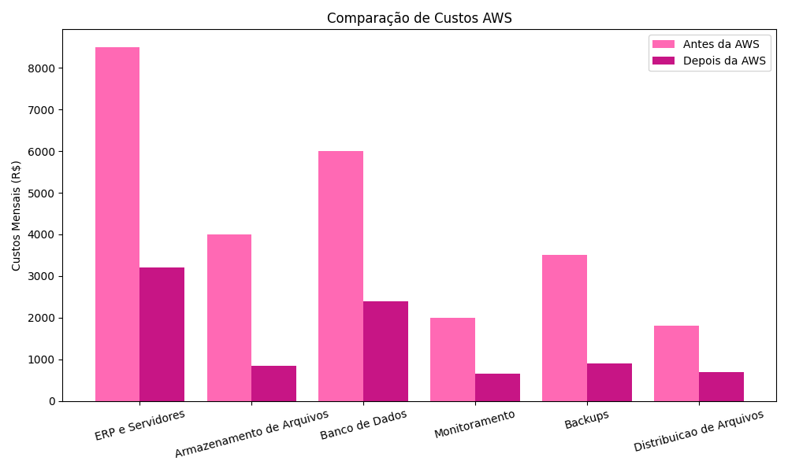
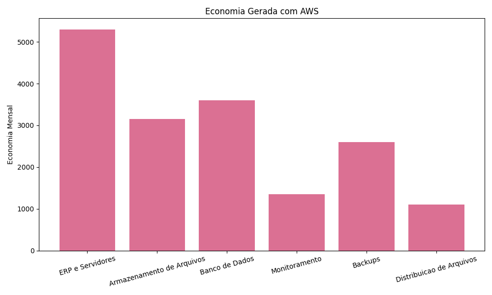

# RELATÓRIO DE IMPLEMENTAÇÃO DE SERVIÇOS AWS

**Data:** 24/05/2026  
**Empresa:** Abstergo Industries  
**Responsável:** Manuella Santos  

## Introdução

Este relatório apresenta o processo de implementação de ferramentas na empresa Abstergo Industries, realizado por Manuella Santos. O objetivo do projeto foi elencar 3 serviços AWS, com a finalidade de realizar diminuição de custos imediatos.

## Descrição do Projeto

O projeto de implementação de ferramentas foi dividido em 3 etapas, cada uma com seus objetivos específicos. A seguir, serão descritas as etapas do projeto:

### Etapa 1:
- **Amazon S3**
- Armazenamento de documentos e backups
- O Amazon S3 será utilizado para armazenar arquivos corporativos, relatórios, contratos e backups da empresa em nuvem, reduzindo custos com servidores físicos e aumentando a segurança dos dados.

### Etapa 2:
- **Amazon EC2**
- Hospedagem do sistema interno da empresa
- O Amazon EC2 permitirá hospedar o sistema ERP e aplicações internas da empresa com maior flexibilidade, disponibilidade e redução de gastos com infraestrutura local.

### Etapa 3:
- **Amazon RDS**
- Gerenciamento de banco de dados
- O Amazon RDS será responsável pelo armazenamento e gerenciamento automatizado do banco de dados da empresa, reduzindo custos operacionais e a necessidade de manutenção manual.

## Conclusão

A implementação de ferramentas na empresa *Abstergo Industries* tem como esperado a redução de custos operacionais, maior segurança das informações, melhoria no desempenho dos sistemas e maior eficiência da infraestrutura tecnológica, o que aumentará a eficiência e a produtividade da empresa. Recomenda-se a continuidade da utilização das ferramentas implementadas e a busca por novas tecnologias que possam melhorar ainda mais os processos da empresa.

## Anexos

- Análise com python
  
  

**Assinatura do Responsável pelo Projeto:**  

Manuella Santos
