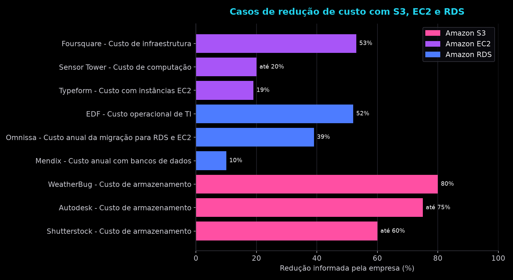
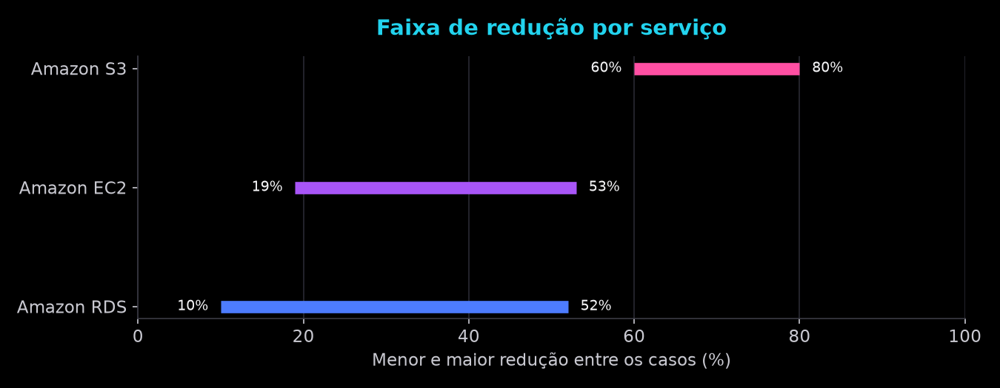

# Análise de Custos com AWS

Projeto desenvolvido durante a trilha **TOTVS - Fundamentos de Engenharia de Dados e Machine Learning**.

O código lê um CSV com casos reais de empresas que reduziram custos usando três serviços da AWS: **S3, EC2 e RDS**. A partir desses dados, o programa mostra um resumo no terminal e gera dois gráficos.

## Serviços utilizados


## O que o código faz

1. Lê o arquivo `casos_aws.csv`, com 9 casos, 3 para cada serviço.
2. Mostra no terminal cada caso, com o valor informado e a base de comparação.
3. Gera dois gráficos:
   - `grafico_casos.png`: mostra a redução de custo de cada caso.
   - `grafico_faixa.png`: mostra a menor e a maior redução encontrada em cada serviço.

### Redução de custos por caso



### Faixa de redução por serviço



## De onde vem os dados

Os dados foram pesquisados em casos reais de empresas que divulgaram informações sobre redução de custos com S3, EC2 e RDS.

Foram utilizados estudos de caso e páginas publicadas pela AWS. Os casos que não tinham relação com esses três serviços ou que não permitiam confirmar o número informado ficaram de fora.

## Os casos

| Serviço | Empresa | Redução | O que foi reduzido |
|---|---|---:|---|
| S3 | Autodesk | até 75% | Custo de armazenamento de backups |
| S3 | Shutterstock | até 60% | Custo de armazenamento, em alguns buckets |
| S3 | WeatherBug | 80% | Custo de armazenamento, em 6 meses |
| EC2 | Foursquare | 53% | Custo de infraestrutura, comparado a hospedagem própria |
| EC2 | Typeform | 19% | Custo com instâncias, ao migrar para Graviton |
| EC2 | Sensor Tower | até 20% | Custo de computação, ao migrar para Graviton |
| RDS | Mendix | 10% | Custo anual com bancos de dados, ao migrar para Graviton |
| RDS | Omnissa | 39% | Custo anual da migração para RDS e EC2 |
| RDS | EDF | 52% | Custo operacional de TI |

Os links dos casos estão na seção **Fontes** e também na coluna `Fonte` do CSV.

## Limitações

- Os números não são comparáveis diretamente, porque cada empresa utilizou uma base de comparação diferente.
- Alguns valores representam uma redução **de até** determinado percentual.
- Os casos utilizados foram publicados pela própria AWS, então existe um possível viés de seleção.
- Os valores encontrados são percentuais. Não há informação suficiente para calcular a economia em dinheiro.
- Os casos da Omnissa e da EDF envolvem mais de um serviço da AWS.
- O caso da Foursquare é de 2012 e foi mantido por apresentar uma comparação direta com hospedagem própria.
- Typeform, Sensor Tower e Mendix utilizaram Graviton. Nesse caso, a economia está relacionada à mudança do tipo de processador dentro da AWS.

## Fontes

### Amazon S3

- [Autodesk](https://aws.amazon.com/blogs/storage/autodesk-adopts-amazon-s3-to-save-75-on-storage-and-modernize-backup-and-recovery)
- [Shutterstock](https://aws.amazon.com/blogs/storage/shutterstock-transforms-it-and-saves-60-on-storage-costs-with-amazon-s3)
- [WeatherBug](https://aws.amazon.com/blogs/storage/how-weatherbug-reduced-storage-costs-by-80-using-amazon-s3-storage-lens-and-kiro-cli/)

### Amazon EC2

- [Foursquare](https://aws.amazon.com/blogs/aws/cost-savings-in-the-cloud-foursquare-and-global-blue/)
- [Typeform](https://aws.amazon.com/solutions/case-studies/typeform-compute-case-study/)
- [Sensor Tower](https://aws.amazon.com/solutions/case-studies/sensor-tower-graviton3-case-study)

### Amazon RDS

- [Mendix](https://aws.amazon.com/solutions/case-studies/mendix-case-study/)
- [Omnissa](https://aws.amazon.com/blogs/database/how-omnissa-saved-millions-by-migrating-to-amazon-rds-and-amazon-ec2)
- [EDF](https://aws.amazon.com/solutions/case-studies/edf-case-study/)

## Estrutura do código

O `arquivo.py` tem algumas funções, cada uma responsável por uma parte do programa:

- `carregar_dados`: lê o CSV e confere se as colunas existem.
- `rotulo_valor`: monta os textos dos valores que aparecem nos gráficos.
- `grafico_casos`: cria o gráfico com os casos individuais.
- `grafico_faixa`: cria o gráfico com a menor e a maior redução por serviço.
- `imprimir_resumo`: mostra os casos no terminal.
- `main`: executa o programa e salva os gráficos.

## Como rodar

Instale as bibliotecas:

```bash
pip install pandas matplotlib
```

Depois execute:

```bash
python arquivo.py
```

O arquivo `casos_aws.csv` precisa estar na mesma pasta do `arquivo.py`.

O programa mostra o resumo no terminal e gera os dois gráficos em PNG.

## Estrutura de arquivos

```text
projeto-aws/
├── arquivo.py
├── casos_aws.csv
├── estilo.mplstyle
├── grafico_casos.png
├── grafico_faixa.png
└── README.md
```
